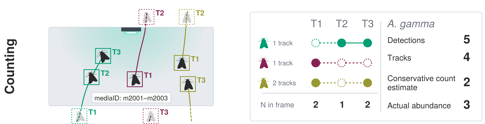
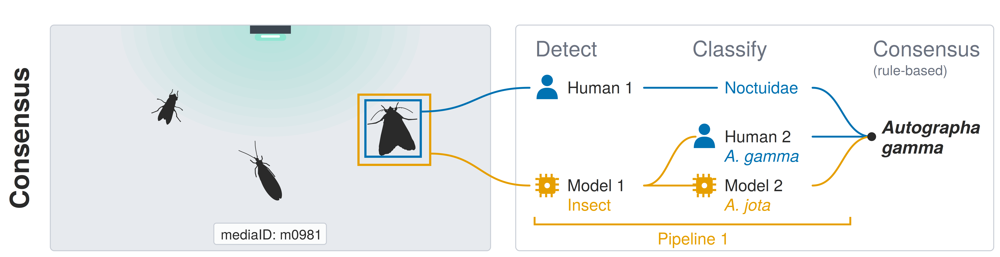
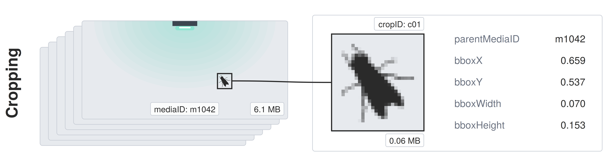
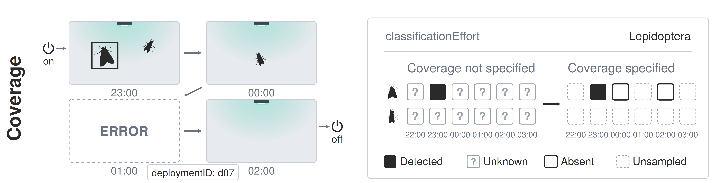

# Implementing Data Standards for Automated Monitoring of Insects

A growing suite of systems is capturing huge volumes of media containing insects. Translating these heterogeneous datasets into interoperable, AI-ready resources remains a major bottleneck for biodiversity monitoring and research. Within InsectAI, an international network to advance the automated monitoring of insects, we organized a community "datathon" — a hackathon for implementing data exchange standards. We mapped eleven datasets from diverse systems to the Camera Trap Data Package standard (Camtrap DP; [Bubnicki et al. 2023](https://doi.org/10.1002/rse2.374)), producing example datasets with documentation and code. We believe that Camtrap DP is the best established standard for automated insect monitoring, and offer proposals for implementation and future development in light of the challenges of automated monitoring of insects ("the five Cs").

## 1. Counting

Insects move unpredictably in front of sensors. Consecutive detections can be linked into "tracks". However, it is very difficult to verify whether separate tracks of one insect type correspond to a single individual. We need to share information on tracks, as well as conservative counts for biological recording.

In Camtrap DP 1.0 `individualID` is the "identifier for the observed individual". Use `individualID` to record the ID for a track, i.e. consecutive, uninterrupted detections of one individual, with value following the convention `trackID:<trackID>`, e.g. `trackID:t0042`. Use event-based observations to group media-level observations into GBIF-ready records that include conservative count information. Event-based observations "should be mutually exclusive, so that their count can be summed". We recommend aggregating observations of each taxon on each day or night, using the maximum simultaneous observations as the count, and the earliest and latest occurrence times as `eventStart` and `eventEnd`. For future versions we propose a `trackID` field, so that `individualID` can be used for individuals that are reidentified within the dataset.

## 2. Consensus

Increasingly complex AI and human-in-the-loop workflows are being used to detect and classify insects. We need to share consensus data for biological analysis, but also a detailed provenance of identifications.

In Camtrap DP 1.0 `observations` is the consensus, and should not include multiple detections or classifications of a single insect in a single media file. Use `classifiedBy` to record a piped sequence of versioned models and/or human annotators responsible for an observation with the convention `<name> (<URI>) | <name> (<URI>)`, e.g. `flatbug (https://doi.org/10.1111/2041-210x.70249) | Jamie Alison (orcid:0000-0002-6787-6192)`. If multiple detections or classifications per insect need to be shared, include a detections tabular resource in the Frictionless Data Package. For future versions we propose a `classifiedByURI` field, and new tables to describe models in detail and capture detections and/or classifications from multiple agents.

## 3. Cropping

Often, very large proportions of media do not contain insects. As such, it can be prudent to host only cropped regions (crops) of media. However, we still need to document all media to flag where insects were searched for, but not detected (see [4. Coverage](#4-coverage)).

In Camtrap DP 1.0 include records in `media` for all uncropped media that were searched for insects, even if empty. Empty media can be assigned an observation with `observationType=blank`. Record unshared media using their original `filePath`, with `filePublic=false`. For observations tied to crops, include crops as additional records in `media` and describe them using `mediaComments` with convention `parentMediaID:<mediaID>`. For future versions we propose a `parentMediaID` field.

## 4. Coverage

We need to share sampling effort to flag when insects were undetected vs. unsampled, including the taxonomic scope of identification. Media are a useful record of sampling effort, but we should also convey when deployments were active and functional.

In Camtrap DP 1.0 the `taxonomic` property indicates taxa present in a dataset – not necessarily the taxa that were searched for. To indicate search effort, add a `classificationEffort` property to the dataset, formatted as the `taxonomic` property, including a property `include=true/false` for each taxon, indicating whether it was/wasn't searched for. If deployments comprise distinct recording sessions or subdeployments, capture temporal sampling effort by recording each session as a distinct deployment. Connect these sessions to a parent deployment using `deploymentTags` with convention `parentDeploymentID:<deploymentID>`. Flag invalid media files as `void` under `mediaComments`. For future versions we propose a `classificationEffort` dataset property, and `parentDeploymentID` and `recordingSchedule` fields in `deployments`.

## 5. Customisation

Systems for automated monitoring of insects are diverse, but form coherent subtypes. We need to convey use of established systems and protocols, and share ancillary data in consistent ways.

In Camtrap DP 1.0, refer to coherent system subtypes using `deploymentTags` with convention `system:<system> | systemURI:<systemURI>`, e.g. `system:mothbox | systemURI:https://doi.org/10.1111/2041-210x.70327`. Record attractants using `baitUse=true` and `deploymentTags` with simple terms such as `attractant:light`, `attractant:colour` or `attractant:flower`. Add ancillary data, for example segmentations or lights, using custom tabular resources keyed to deployments, media or observations, or use a generic entity-attribute-value assertions table (fields: `subjectTable`, `subjectID`, `property`, `value`, `unit`, `vocabularyURI`). For future versions we propose to replace `baitUse` with `attractantType` and to add one or more assertions tables to capture ancillary data.
